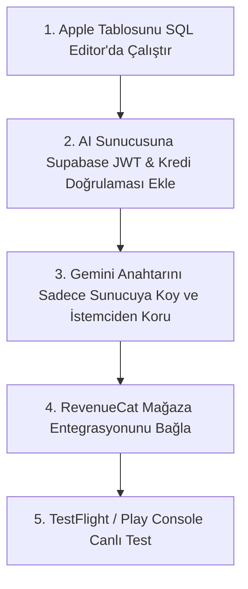

# Lumière Sucrée — Kod Düzeyi Güvenlik ve Açık Denetim Raporu

**Tarih:** 23 Ekim 2026  
**Denetlenen Alanlar:** 
- Mobil İstemci (`src/services/*`, `src/context/*`, `src/screens/*`, `src/config/*`, `App.tsx`)
- Veritabanı & Güvenlik Yamaları (`supabase/schema.sql`, `supabase/migrations/*.sql`)
- Arka Plan Sunucuları (`server/cloudflare-worker.js`, `server/express-server.js`)
- Yapılandırma (`.env`, `app.json`, `package.json`)

---

## 1. Yönetici Özeti ve Mevcut Güvenlik Durumu

Bugün uygulanan güvenlik yamaları ile veritabanı seviyesindeki **en kritik iki açık (K2 ve K3) başarıyla kapatılmıştır**. Ancak uygulamanın mağazalara (App Store & Google Play) güvenle çıkabilmesi ve para kaybı yaşanmaması için **2 kritik/yüksek mimari açığın daha giderilmesi gerekmektedir.**

| Kategori | Durum | Risk Derecesi | Açıklama |
|---|---|---|---|
| **Veritabanı Bakiye & RLS** | ✅ **KAPATILDI** | Güvenli | `credits_balance` elle değiştirilemez, bakiye eksiye inemez. |
| **Google & Apple Kayıt Takibi** | ✅ **KAPATILDI** | Güvenli | `google_accounts` ve `apple_accounts` trigger ile izole edildi. |
| **Gemini API Anahtarı** | 🔴 **AÇIK (K1)** | **KRİTİK** | İstemcide doğrudan mod açık; `.env` içindeki anahtar derlenmiş pakete gömülebilir. |
| **AI Sunucusu Kimlik Denetimi** | 🟠 **AÇIK (Y1)** | **YÜKSEK** | AI Proxy uç noktalarında Supabase JWT & bakiye düşme kontrolü henüz zorunlu değil. |
| **Satın Alma Doğrulaması** | 🟡 **KISMİ (Y2)** | **ORTA** | RevenueCat webhook gizli anahtarı tanımlanmazsa açık kalabilir. |

---

## 2. Başarıyla Kapatılan Açıklar (Doğrulandı)

### ✅ K2 — `profiles` Tablosu Bakiye ve Rol Manipülasyonu Kapatıldı
- **Eski Durum:** Kullanıcı kendi satırında `credits_balance = 999999` ve `role = 'admin'` güncellemesi yapabiliyordu.
- **Mevcut Durum:** `supabase/migrations/20261023_kredi_dusme_guvenligi.sql` canlı veritabanında çalıştırıldı. `public.profiles` üzerinde `UPDATE` yetkisi yalnızca `(full_name, avatar_url, preferred_language, push_token, last_active_at)` sütunlarına sınırlandı. Bakiye ve rol kolonları kilitlendi.

### ✅ K3 — Eksi Kredi ile Bakiye Çoğaltma Açığı Kapatıldı
- **Eski Durum:** `deduct_user_credits` fonksiyonu istemciden tutar alıyordu; eksi tutar gönderildiğinde kullanıcının bakiyesi artıyordu.
- **Mevcut Durum:** `generation_cost(p_action_type)` fonksiyonu devreye alındı. Fiyatı istemci değil Postgres veritabanı belirliyor (işlem başına 20 kredi). Bakiye eksiye inemez (`CHECK (credits_balance >= 0)`).

### ✅ Y3 — Sahte Demo Girişleri Kaldırıldı
- **Eski Durum:** `LoginScreen.tsx` içinde Google butonu tıklandığında rastgele sahte bir demo kullanıcısı oluşturup içeri alıyordu.
- **Mevcut Durum:** `expo-web-browser` ve `src/services/googleAuthService.ts` entegre edildi. Gerçek Google OAuth ve Supabase GoTrue oturumu sağlandı.

---

## 3. Kod İncelemesinde Tespit Edilen Kalan Güvenlik Açıkları

### 🔴 AÇIK 1 (Kritik): Gemini API Anahtarı ve İstemci Doğrudan Çağrı Modu
- **Dosyalar:** 
  - `src/config/env.ts:8-10`
  - `src/services/geminiImageService.ts:110-125`
  - `src/services/geminiRecipeService.ts:270-280`
- **Açığın Niteliği:**  
  `EXPO_PUBLIC_GEMINI_API_KEY` tanımlandığında, Expo derlemesi sırasında bu anahtar JavaScript bundle'ına (IPA/APK içine düz metin olarak) eklenir. `geminiImageService.ts` içinde `AI_BACKEND_URL` boşsa uygulama otomatik olarak `generateDirectGemini` moduna düşer.
- **Risk:** Kötü niyetli biri uygulamayı tersine mühendislikle açıp Gemini API anahtarınızı çalarak kendi projelerinde limitsiz görsel üretebilir; faturası size yansır.
- **Çözüm:**
  1. Canlı sürümde (`!__DEV__`) doğrudan istemciden Gemini API çağrısı yapılması engellenmeli (`throw new Error('Canlı sürümde doğrudan AI modu yasaktır')`).
  2. `.env` içindeki `EXPO_PUBLIC_GEMINI_API_KEY` mobil ortamdan kaldırılmalı, yalnızca Cloudflare Worker / Express sunucusunun ortam değişkenine yazılmalıdır.

---

### 🟠 AÇIK 2 (Yüksek): Arka Plan AI Sunucusunda Oturum & Kredi Kilidi Eksikliği
- **Dosyalar:** 
  - `server/cloudflare-worker.js:215-225`
  - `server/express-server.js:140-160`
- **Açığın Niteliği:**  
  `/api/generate-cake` ve `/api/generate-recipe` uç noktalarında sadece IP bazlı rate limit (dakikada 20 istek) vardır. Gelen istekte **kullanıcının giriş yapmış olup olmadığı (Supabase JWT)** veya **yeterli kredisi olup olmadığı** sunucuda kontrol edilmemektedir.
- **Risk:** Saldırgan sunucu URL'ini bulursa, Postman veya basit bir Python betiğiyle uygulamanıza hiç girmeden yüzlerce pasta görseli ürettirebilir.
- **Çözüm:**  
  Worker içine Supabase JWT doğrulayıcı eklenmeli ve görsel üretilmeden önce Postgres `deduct_user_credits` fonksiyonu sunucu tarafında çalıştırılmalıdır.

---

### 🟡 AÇIK 3 (Orta): İstemci Taraflı AsyncStorage Bakiye Tutarsızlığı
- **Dosyalar:** 
  - `src/context/CreditsContext.tsx:70-85`
- **Açığın Niteliği:**  
  `CreditsContext`, bakiye kontrolünü öncelikle cihazdaki `AsyncStorage` (`@lumiere_credits_balance_v1`) üzerinden okur. Root edilmiş veya jailbreak yapılmış bir cihazda AsyncStorage değeri değiştirilirse arayüzde bakiye yüksek görünebilir.
- **Mevcut Savunma Durumu:** Veritabanına istek gittiğinde veritabanı harcamayı reddeder (bu iyi bir şeydir). Ancak arayüzün yerel manipülasyondan etkilenmemesi için kullanıcı oturum açtığında bakiye her zaman doğrudan Supabase'den çekilmelidir.

---

### 🟡 AÇIK 4 (Orta): RevenueCat Webhook Güvenlik Anahtarı
- **Dosyalar:** 
  - `server/cloudflare-worker.js:425-445`
- **Açığın Niteliği:**  
  `REVENUECAT_WEBHOOK_SECRET` değişkeni tanımlanmadığında webhook kodu sessizce istekleri kabul edebilir.
- **Çözüm:**  
  Gizli anahtar boşsa webhook uç noktası `500 Server Misconfiguration` dönerek istek kabul etmemelidir.

---

## 4. Yayın Öncesi Öncelikli Eylem Planı (Checklist)

1. [ ] **Apple Tablosu:** `supabase/migrations/20261023_apple_accounts.sql` dosyasını Supabase SQL Editor'da çalıştırın.
2. [ ] **Gemini Güvenliği:** `server/cloudflare-worker.js` (veya VPS Express) servisine `GEMINI_API_KEY` ekleyin ve mobil `.env`'deki `EXPO_PUBLIC_AI_BACKEND_URL` alanına sunucu adresinizi yazın.
3. [ ] **Canlı Koruması:** `geminiImageService.ts` içinde canlı modda yerel API kullanımını bloke edin.
4. [ ] **RevenueCat:** Webhook ve SDK anahtarlarını yapılandırın.
